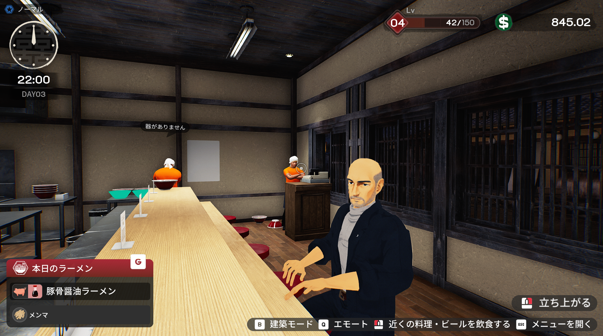

# Ramen VRM MOD



Japanese Ramen Simulator(Steam AppID 4968640)のプレイヤーキャラクターを、
**各プレイヤーが自分で用意した VRM モデル**で表示する非公式 MOD です。

- 揺れもの(髪・スカートなど)と自動まばたき
- 表示方法を「ライティングあり」「アニメ調」から選べる
- ゲーム中に **F5 / F6** で見た目を切り替え(元の見た目 ⇔ 各 VRM)
- マルチプレイ: Steam のフレンド同士で、**相手も同じ VRM ファイルを持っていれば**お互いの VRM が見える

## ダウンロード

**[最新版のダウンロード(Releases)](https://github.com/503bad/Jpanese_ramen_VRM/releases/latest)**

ページ下部の「Assets」にある `RamenVRM_<版>.zip` をダウンロードしてください
(「Source code」はソースコードなので、遊ぶだけなら不要です)。

動作環境: Windows 10 / 11、Steam 版の Japanese Ramen Simulator。

## インストールと使い方

1. ダウンロードした zip を任意のフォルダに展開します(ゲームのフォルダの中である必要はありません)。
2. 展開したフォルダの **`install.bat`** をダブルクリックし、表示される内容を確認して `y` を入力します。
   - ゲームのインストール先は自動で検出します。
   - MOD をゲームに読み込ませる土台(UE4SS)も同梱しています。既に別の MOD で入れている場合はそれを使い、上書きしません。
3. 同じフォルダにある **`models` フォルダ**に `.vrm` ファイルを置きます(何体でも可。インストール後に追加しても構いません)。
4. ゲームを起動すると、自分のキャラクターが VRM で表示されます(ゲーム開始の数秒後に切り替わります)。

| キー | 動作 |
|---|---|
| F6 / F5 | 次 / 前の見た目に切り替え(元の見た目 → models の VRM をファイル名順) |
| F7 | 表示方法の切り替え(ライティングあり ⇔ アニメ調) |

選んだモデルと表示方法は `ドキュメント\RamenVRM\config.ini` に保存され、次回も使われます。
細かい設定やトラブル時の対処は [docs/INSTALL.md](docs/INSTALL.md) を参照してください。

### マルチプレイで見せ合う

- お互いに MOD を入れ、**同じ VRM ファイル**を各自の `models` フォルダに置きます(ファイル名は違っていても構いません)。
- **Steam のフレンド同士**で遊ぶと、相手の画面でもあなたのキャラクターが VRM で表示されます。
- MOD はモデルのファイルを送りません。Steam の「プレイ中の状態表示(リッチプレゼンス)」に、使っているモデルの ID と
  ゲーム内の名前だけを載せます。不要なら `config.ini` で `share_with_friends = 0` にしてください。
- MOD を入れていない人、フレンドでない人、同じファイルを持っていない人には、元のキャラクターが見えます。

### アップデート

新しい版の zip を**前と同じフォルダに上書きで展開**し、`install.bat` を実行してください。
`models` フォルダの VRM はそのまま使えます。別のフォルダに展開した場合は、VRM を新しい `models` に移してください。

### アンインストール

`uninstall.bat` を実行します。インストール時に置いたファイルだけを削除し、ゲームを元の状態に戻します。
`models` フォルダの VRM は削除しません。

## 現在の状態(v0.6.0)

| 項目 | 状態 |
|---|---|
| 自分のキャラクターの VRM 表示(形状・動き・揺れもの・テクスチャ) | 動作確認済み |
| 専用マテリアル | 動作確認済み |
| F5 / F6 での切り替え | 動作確認済み(v0.6.0 で「ゲーム中いつでも」に変更) |
| F7 での表示方法の切り替え | 実機確認待ち |
| `install.bat` の隣の `models` フォルダ | 実機確認待ち |
| マルチプレイ(フレンド同士での表示) | **2 人での動作確認待ち** |
| ロッカーのカスタマイズ画面のプレビュー | 非対応(元の見た目のまま表示されます) |
| 表情 | まばたきのみ(口の動き・感情表現は未対応) |

## 注意

- 非公式 MOD です。ゲームの開発元とは関係ありません。利用は自己責任でお願いします。
- ゲームのアップデートで動かなくなることがあります。MOD は失敗を検出すると、元の見た目に戻して停止します。
- ウイルス対策ソフトが `dwmapi.dll`(UE4SS をゲームに読み込ませるファイル)に警告を出すことがあります。
- VRM モデルの利用は、各モデルの利用条件(VRM の meta に記載)に従ってください。
  マルチプレイで相手に見せるには相手も同じファイルを持っている必要があります。モデルの受け渡しは利用条件の範囲で各自行ってください。
- 不具合の報告には、ゲームの `RealRamenSimulator\Binaries\Win64\ue4ss\UE4SS.log` を添えてください(行頭が `[RamenVRM]` の記録)。

## 開発者向け

- 設計: [docs/DESIGN.md](docs/DESIGN.md)
- ビルド・配布物の作成: [docs/BUILD.md](docs/BUILD.md)
- ゲームの調査結果: [docs/RESEARCH.md](docs/RESEARCH.md)
- 出典・ライセンス: [docs/CREDITS.md](docs/CREDITS.md)
- 開発の経緯と引き継ぎメモ: [CLAUDE.md](CLAUDE.md)

```
core/              エンジン非依存の C++17 ライブラリ(rvrm): VRM 解析・座標変換・リターゲット・
                   CPU スキニング・SpringBone・一人称表示。単体テスト付き
tools/vrm_inspect  VRM の中身・利用許諾の表示、OBJ 書き出し、処理時間の計測(配布物の tools\ にも同梱)
mod/RamenVRM       UE4SS の C++ MOD(ゲームとの接点だけを持つ)
ue/                専用マテリアル: UE 5.7 のコンテンツ用プロジェクトと、生成・pak 化のスクリプト
scripts/           install.bat / uninstall.bat / ramen_vrm_setup.ps1 / make_package.ps1
third_party/       cgltf(MIT)、同梱する UE4SS の情報とライセンス(MIT ほか)
```

ビルドには Visual Studio 2022 以降・CMake・Rust(UE4SS 用)・UE 5.7(専用マテリアル用)が必要です。
UE4SS のソースは同梱する UE4SS.dll と同じコミットのものを `external/` に取得します(Epic Games と GitHub のアカウント連携が必要)。

## ライセンス・クレジット

同梱している第三者のソフトウェア(UE4SS、cgltf ほか)のライセンスは、配布物の `licenses\` と
[docs/CREDITS.md](docs/CREDITS.md) を参照してください。
